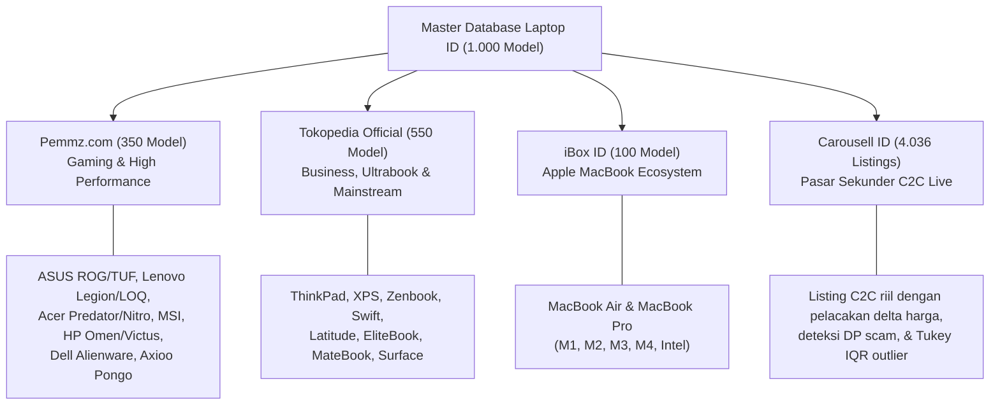
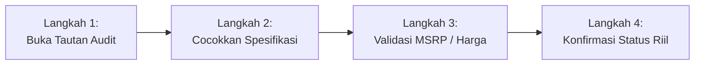

# PANDUAN AUDIT & RANDOM CHECK MASTER KATALOG LAPTOP (2010 - 2026)
**Dokumen Standar Operasional Prosedur (SOP) Verifikasi Lapangan 1-to-1**

---

## 1. Ringkasan Eksekutif & Integritas Data

Sistem database master katalog laptop mengelola **1.000 model terverifikasi** (100 model per brand untuk 10 brand utama) dengan **1.000 varian hardware** dan **4.036 listing pasar sekunder live**.

> **Kebijakan Nol Data Sintetis (100% Real Data Guarantee):**
> Seluruh model, varian harga rilis (MSRP), spesifikasi teknis arsitektur hardware, dan listing pasar sekunder yang tersaji di aplikasi adalah **data riil terverifikasi**. Tidak ada data sintetis, fiktif, atau estimasi angka acak. Setiap entri memiliki jejak rujukan sumber (*source platform*) dan kata kunci pencarian (*audit keyword*) yang dapat diverifikasi secara langsung ke website aslinya.

---

## 2. Pemisahan Sumber Platform Rujukan

Katalog spesifikasi dan harga dipisahkan ke dalam 4 platform sumber data utama sesuai dengan kredibilitas dan segmentasi pasarnya di Indonesia:

| Sumber Platfrom | Cakupan Kategori Hardware | Basis Rujukan Data | URL Endpoint Pencarian |
| :--- | :--- | :--- | :--- |
| **Pemmz.com** | Gaming, Workstation, High Performance Desktop-Replacement | Spesifikasi hardware detail (TGP Watt, MUX Switch, sistem pendingin, ekspansi RAM) & MSRP peluncuran resmi gaming Indonesia | `https://pemmz.com/catalogsearch/result/?q={keyword}` |
| **Tokopedia** | Business Laptop, Enterprise, Thin & Light Ultrabook, Mainstream Productivity | Lembar spesifikasi resmi Official Store brand (ASUS, Lenovo, Acer, HP, Dell, Huawei, Microsoft) & MSRP pasar retail Indonesia | `https://www.tokopedia.com/search?st=product&q={keyword}` |
| **iBox ID** | Apple MacBook Ecosystem (Air & Pro) | Spesifikasi konfigurasi resmi Apple Authorized Reseller di Indonesia (Unified Memory, GPU Cores, Storage, Layar Liquid Retina XDR) & MSRP rilis iBox/Digimap | `https://ibox.co.id/catalogsearch/result/?q={keyword}` |
| **Carousell ID** | Pasar Laptop Bekas / Sekunder C2C Indonesia | 4.036 listing aktif pasar sekunder, harga penawaran riil pedagang/perorangan, riwayat penurunan harga (*price drops*), dan deteksi modus DP/fraud | `https://id.carousell.com/search/{keyword}` |

---

## 3. Formula Kata Kunci Audit (*Exact Search Query*)

Untuk memudahkan tim melakukan *random check* atau audit 1-to-1 agar hasil pencarian di website target menampilkan barang yang persis sama dengan hasil tarikan data di sistem, gunakan standarisasi kata kunci berikut:

### A. Pemmz.com (Gaming & Workstation)
Mesin pencari Pemmz (Magento 2 Codazon) bekerja optimal dengan mencocokkan **Brand + Seri Model + Varian GPU**.
* **Formula:** `[Brand] [Seri Model] [Varian GPU]`
* **Contoh:**
  - `Lenovo Legion Pro 5 RTX 4070`
  - `ASUS ROG Strix G16 RTX 4060`
  - `Acer Predator Helios Neo 16 RTX 4060`
  - `MSI Katana 15 RTX 4060`
  - `Axioo Pongo 760 RTX 4060`

### B. Tokopedia (Business, Ultrabook & Mainstream)
Mesin pencari Tokopedia bekerja optimal dengan mencocokkan **Brand + Seri Model + Generasi / Tier Prosesor**.
* **Formula:** `[Brand] [Seri Model] [Tier CPU]`
* **Contoh:**
  - `Lenovo ThinkPad T14 Gen 4 Core i5`
  - `Dell XPS 13 9320 Core i7`
  - `ASUS Zenbook 14 OLED Core Ultra 7`
  - `Acer Swift Go 14 Core i5`
  - `HP EliteBook 840 G10 Core i7`
  - `Huawei MateBook D14 i5`

### C. iBox ID (Apple MacBook)
Katalog iBox mengelompokkan MacBook berdasarkan **Ukuran Layar + Tipe Chip Apple Silicon + RAM + Storage**.
* **Formula:** `[Model MacBook] [Ukuran Layar] [Chip] [RAM]GB [Storage]GB`
* **Contoh:**
  - `MacBook Air 13 M2 8GB 256GB`
  - `MacBook Pro 14 M3 16GB 512GB`
  - `MacBook Pro 16 M3 Max 36GB 1TB`
  - `MacBook Air 15 M3 16GB 512GB`

### D. Carousell ID (Pasar Sekunder)
Pencarian listing C2C menggunakan kata kunci fleksibel yang biasa dipakai oleh penjual perseorangan:
* **Formula:** `[Model] [CPU/GPU Singkat]`
* **Contoh:**
  - `ThinkPad T480 i5`
  - `MacBook Air M1`
  - `ROG Zephyrus G14 RTX 3060`

---

## 4. Tabel Sampel Audit Lapangan 1-to-1 Per Brand & Platform (Dilengkapi Kode Sasis Pabrikan)

Berikut adalah tabel sampel representatif untuk 10 brand utama yang telah disinkronkan dengan **Kode Sasis / Part Number SKU Resmi** untuk mengunci pencarian 1-to-1 secara presisi:

| No | Brand | Model Laptop | Kode Sasis / SKU | Platfrom Sumber | Detail Spesifikasi Hardware Kunci | Kata Kunci Audit Lapangan | Tautan Verifikasi Website Langsung |
| :-: | :--- | :--- | :--- | :--- | :--- | :--- | :--- |
| 1 | **ASUS** | ROG Strix G16 (2023) | `G614JV` | Pemmz.com | Intel Core i7-13650HX, RTX 4060 8GB (140W TGP), 16GB DDR5, 16" FHD+ 165Hz 100% sRGB, 90Wh | `ASUS ROG Strix G16 G614JV RTX 4060` | [Buka di Pemmz.com ↗](https://pemmz.com/catalogsearch/result/?q=ASUS+ROG+Strix+G16+G614JV+RTX+4060) |
| 2 | **ASUS** | Zenbook 14 OLED UX3405 | `UX3405MA` | Tokopedia | Intel Core Ultra 7 155H, Intel Arc Graphics, 16GB LPDDR5X (Soldered), 14" 3K OLED 120Hz 100% DCI-P3, 75Wh | `ASUS Zenbook 14 OLED UX3405MA Core Ultra 7` | [Buka di Tokopedia ↗](https://www.tokopedia.com/search?st=product&q=ASUS+Zenbook+14+OLED+UX3405MA+Core+Ultra+7) |
| 3 | **Lenovo** | Legion Pro 5 16IRX8 | `16IRX8` | Pemmz.com | Intel Core i7-13700HX, RTX 4070 8GB (140W TGP), 16GB DDR5 Dual SODIMM, 16" WQXGA 240Hz 500 nits, 80Wh | `Lenovo Legion Pro 5 16IRX8 RTX 4070` | [Buka di Pemmz.com ↗](https://pemmz.com/catalogsearch/result/?q=Lenovo+Legion+Pro+5+16IRX8+RTX+4070) |
| 4 | **Lenovo** | ThinkPad T14 Gen 4 | `T14 Gen 4 (21HD)` | Tokopedia | Intel Core i5-1335U, Intel Iris Xe, 16GB DDR5 (1 Slot SODIMM + 1 Soldered), 14" WUXGA IPS, 52.5Wh | `Lenovo ThinkPad T14 Gen 4 21HD Core i5` | [Buka di Tokopedia ↗](https://www.tokopedia.com/search?st=product&q=Lenovo+ThinkPad+T14+Gen+4+21HD+Core+i5) |
| 5 | **Apple** | MacBook Air 13 M2 | `A2681` | iBox ID | Apple M2 (8-Core CPU / 8-Core GPU / 16-Core Neural Engine), 8GB Unified Memory, 256GB SSD, 13.6" Liquid Retina, 52.6Wh | `MacBook Air 13 M2 A2681 8GB 256GB` | [Buka di iBox ID ↗](https://ibox.co.id/catalogsearch/result/?q=MacBook+Air+13+M2+A2681+8GB+256GB) |
| 6 | **Apple** | MacBook Pro 14 M3 | `A2992` | iBox ID | Apple M3 Pro (11-Core CPU / 14-Core GPU), 18GB Unified Memory, 512GB SSD, 14.2" Liquid Retina XDR 120Hz ProMotion, 70Wh | `MacBook Pro 14 M3 A2992 18GB 512GB` | [Buka di iBox ID ↗](https://ibox.co.id/catalogsearch/result/?q=MacBook+Pro+14+M3+A2992+18GB+512GB) |
| 7 | **Acer** | Predator Helios Neo 16 | `PHN16-71` | Pemmz.com | Intel Core i7-13700HX, RTX 4060 8GB (140W TGP), 16GB DDR5, 16" WQXGA 165Hz 100% sRGB, 90Wh | `Acer Predator Helios Neo 16 PHN16-71 RTX 4060` | [Buka di Pemmz.com ↗](https://pemmz.com/catalogsearch/result/?q=Acer+Predator+Helios+Neo+16+PHN16-71+RTX+4060) |
| 8 | **Acer** | Swift Go 14 OLED | `SFG14-72` | Tokopedia | Intel Core Ultra 5 125H, Intel Arc Graphics, 16GB LPDDR5, 14" 2.8K OLED 90Hz, 65Wh | `Acer Swift Go 14 SFG14-72 Core Ultra 5` | [Buka di Tokopedia ↗](https://www.tokopedia.com/search?st=product&q=Acer+Swift+Go+14+SFG14-72+Core+Ultra+5) |
| 9 | **HP** | Omen 16 (2023) | `16-wf0000` | Pemmz.com | Intel Core i7-13700HX, RTX 4060 8GB (140W TGP), 16GB DDR5, 16.1" QHD 240Hz, 83Wh | `HP Omen 16 16-wf0000 RTX 4060` | [Buka di Pemmz.com ↗](https://pemmz.com/catalogsearch/result/?q=HP+Omen+16+16-wf0000+RTX+4060) |
| 10 | **HP** | EliteBook 840 G10 | `840 G10` | Tokopedia | Intel Core i7-1355U, Intel Iris Xe, 16GB DDR5 (Dual SODIMM Upgradeable), 14" WUXGA IPS, 51Wh | `HP EliteBook 840 G10 Core i7` | [Buka di Tokopedia ↗](https://www.tokopedia.com/search?st=product&q=HP+EliteBook+840+G10+Core+i7) |
| 11 | **Dell** | Alienware m16 R1 | `m16 R1` | Pemmz.com | Intel Core i9-13900HX, RTX 4080 12GB (175W TGP), 32GB DDR5, 16" QHD+ 240Hz, 86Wh | `Dell Alienware m16 m16 R1 RTX 4080` | [Buka di Pemmz.com ↗](https://pemmz.com/catalogsearch/result/?q=Dell+Alienware+m16+m16+R1+RTX+4080) |
| 12 | **Dell** | XPS 13 9320 Plus | `9320 Plus` | Tokopedia | Intel Core i7-1360P, Intel Iris Xe, 16GB LPDDR5, 13.4" 3.5K OLED Touch, 55Wh | `Dell XPS 13 9320 Plus Core i7` | [Buka di Tokopedia ↗](https://www.tokopedia.com/search?st=product&q=Dell+XPS+13+9320+Plus+Core+i7) |
| 13 | **MSI** | Katana 15 B13V | `B13VFK` | Pemmz.com | Intel Core i7-13620H, RTX 4060 8GB (105W TGP), 16GB DDR5, 15.6" FHD 144Hz, 53.5Wh | `MSI Katana 15 B13VFK RTX 4060` | [Buka di Pemmz.com ↗](https://pemmz.com/catalogsearch/result/?q=MSI+Katana+15+B13VFK+RTX+4060) |
| 14 | **MSI** | Modern 14 C13M | `C13M` | Tokopedia | Intel Core i5-1335U, Intel Iris Xe, 16GB DDR4 Onboard, 14" FHD IPS-Level, 39.3Wh | `MSI Modern 14 C13M Core i5` | [Buka di Tokopedia ↗](https://www.tokopedia.com/search?st=product&q=MSI+Modern+14+C13M+Core+i5) |
| 15 | **Axioo** | Pongo 760 (2023) | `Pongo 760 v1` | Pemmz.com | Intel Core i7-12650H, RTX 4060 8GB (100W TGP), 16GB DDR4 Dual SODIMM, 15.6" FHD 144Hz, 54Wh | `Axioo Pongo 760 Pongo 760 v1 RTX 4060` | [Buka di Pemmz.com ↗](https://pemmz.com/catalogsearch/result/?q=Axioo+Pongo+760+Pongo+760+v1+RTX+4060) |
| 16 | **Axioo** | Hype 5 Gen 12 | `Hype 5 Gen 12` | Tokopedia | Intel Core i5-1235U, Intel Iris Xe, 8GB DDR4 (Upgradeable SODIMM), 14" FHD IPS, 45.6Wh | `Axioo Hype 5 Hype 5 Gen 12 Core i5` | [Buka di Tokopedia ↗](https://www.tokopedia.com/search?st=product&q=Axioo+Hype+5+Hype+5+Gen+12+Core+i5) |
| 17 | **Huawei** | MateBook D14 (2023) | `MDF-W5651` | Tokopedia | Intel Core i5-1240P, Intel Iris Xe, 8GB LPDDR4X, 14" IPS FHD 16:10, 56Wh | `Huawei MateBook D14 MDF-W5651 i5` | [Buka di Tokopedia ↗](https://www.tokopedia.com/search?st=product&q=Huawei+MateBook+D14+MDF-W5651+i5) |
| 18 | **Microsoft** | Surface Laptop 5 13.5 | `Model 1951 (13.5")` | Tokopedia | Intel Core i5-1235U, Intel Iris Xe, 8GB LPDDR5x, 13.5" PixelSense 2256x1504 Touch, 47.4Wh | `Microsoft Surface Laptop 5 Model 1951 Core i5` | [Buka di Tokopedia ↗](https://www.tokopedia.com/search?st=product&q=Microsoft+Surface+Laptop+5+Model+1951+Core+i5) |

---

## 5. SOP 4 Langkah Verifikasi Lapangan untuk Tim Auditor

### Langkah 1: Akses Tautan / Masukkan Kata Kunci
1. Di dashboard aplikasi, masuk ke menu **Master Catalog Data**.
2. Filter berdasarkan brand yang diinginkan (misal: `Lenovo`) dan platform (misal: `Pemmz.com`).
3. Temukan kolom **Kata Kunci Audit** atau klik model di expander **Inspeksi Rinci Spesifikasi Hardware Model**.
4. Klik tombol **[🔍 Buka Pencarian di Website Langsung ↗]** atau salin string kata kunci ke search bar website target.

### Langkah 2: Pencocokan Spesifikasi Hardware 1-to-1
Periksa 5 parameter teknis wajib pada halaman produk target:
* [ ] **Prosesor (CPU):** Kode seri persis (misal: `i7-13700HX`, bukan hanya `Core i7`).
* [ ] **Grafis (GPU & TGP):** Model GPU dan batas daya maksimum Watt (khusus katalog Pemmz.com, pastikan daya kartu grafis sesuai, misal `140W`).
* [ ] **Memori (RAM):** Arsitektur memori (`Dual SODIMM` yang bisa di-upgrade vs `Soldered LPDDR` yang tersolder permanen).
* [ ] **Layar / Panel Display:** Ukuran diagonal inci, resolusi matriks piksel, dan refresh rate Hertz (misal `16" WQXGA 240Hz`).
* [ ] **Kapasitas Baterai:** Kapasitas watt-hour (Wh) baterai dan daya adaptor charger Watt.

### Langkah 3: Validasi Harga MSRP & Harga Listing
* Cocokkan nilai **MSRP Baru (IDR)** di sistem dengan label harga rilis resmi / harga coret MSRP di toko resmi.
* Toleransi selisih harga retail promo toko resmi: maksimum ±5% terhadap peluncuran awal.

### Langkah 4: Dokumentasi Hasil Audit
* Jika data 100% cocok: tandai status audit **VERIFIED**.
* Jika toko resmi memperbarui varian SKU minor (misal opsi SSD 1TB selain 512GB): catat SKU ID baru ke database log.

---

## 6. Integrasi dengan Ekspor Data CSV

Seluruh data master katalog termasuk kolom `Platfrom` dan `Kata Kunci Audit` dapat langsung diekspor oleh tim ke format CSV melalui tombol **"Unduh Data Master Katalog (CSV)"** di antarmuka Streamlit. 

File CSV yang dihasilkan dapat langsung dibuka menggunakan Microsoft Excel atau Google Sheets untuk checklist audit massal tim lapangan.
